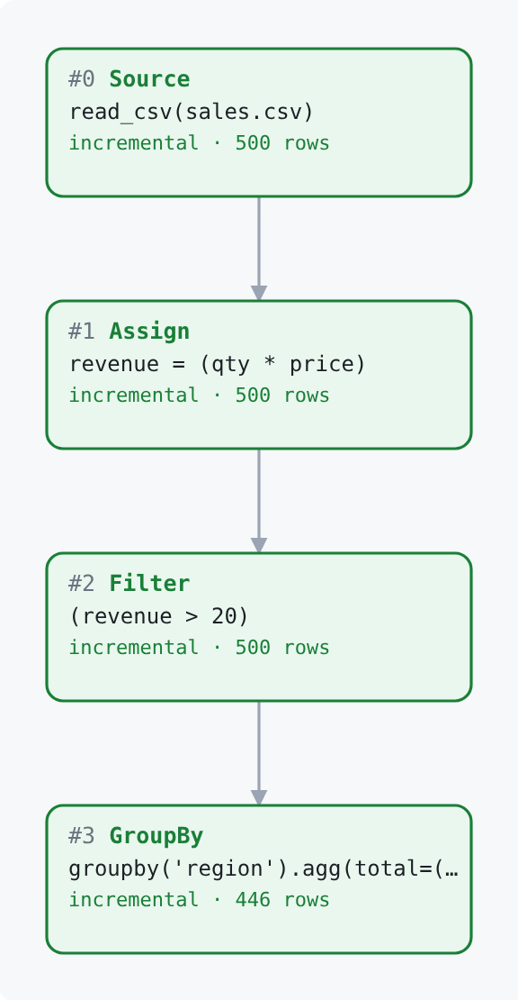
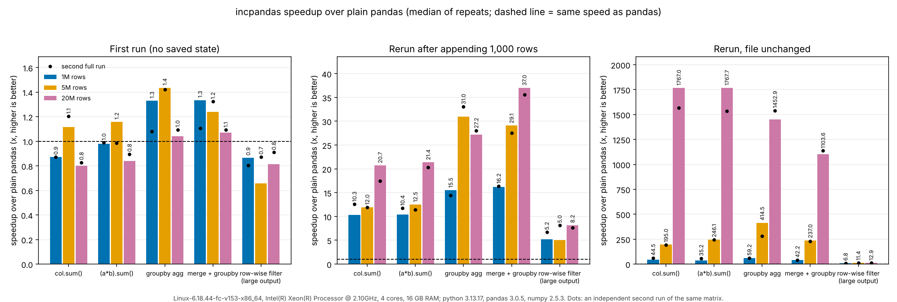
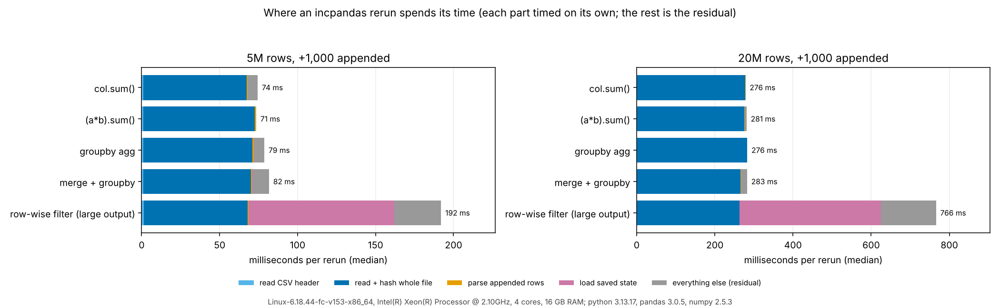

# incpandas

Use `import incpandas as pd` instead of `import pandas as pd`. When new rows are appended to a CSV, a rerun processes only the new rows. Anything unsupported runs in real pandas, so results are never wrong.

## Quick start

Make a sample file once:

```python
import numpy as np, pandas
rng = np.random.default_rng(0)
pandas.DataFrame({"region": rng.choice(list("ABCD"), 200_000), "qty": rng.integers(1, 20, 200_000),
                  "price": rng.normal(10, 3, 200_000).round(2)}).to_csv("sales.csv", index=False)
```

Then run this script. The only change from a pandas script is the import.

```python
import incpandas as pd

df = pd.read_csv("sales.csv")
df["revenue"] = df.qty * df.price
df = df[df.revenue > 20]
out = df.groupby("region").agg(total=("revenue", "sum"), orders=("qty", "count"))
print(out)
```

Append rows to `sales.csv` and run it again. Only the appended rows are read and processed. Set `INCPANDAS_LOG=1` to see
`incpandas: processed 1,000 new rows, skipped 200,000 (4 incremental)`. `python examples/01_quickstart.py` does all of this in one file.

## How it works



1. **A plan of nodes.** `read_csv`, column math, filters, column selection, `rename`/`drop`/`astype`/`dropna`/`fillna`/`assign`, reductions, `groupby` and `merge` are recorded as nodes in a plan. Nothing runs until you use the result (`print`, `len`, `.to_pandas()`, ...).
2. **Append detection.** The source node remembers the size, SHA-256 and parsed dtypes of the file it saw last time. On a rerun, if the old bytes are unchanged and the file only grew by whole rows, only the new tail is parsed, with the saved dtypes, so it parses as a full read would.
3. **The delta flows through the plan.** Row-wise nodes transform just the new rows. A reduction keeps running totals. A `groupby` keeps per-group partial aggregates (sum, count, min, max) and merges the new rows' partials in. A `merge` merges only the new left rows.
4. **Saved state.** Each plan has an index pickle in the cache folder, plus the final result saved as a list of chunk files. An append writes one small chunk. See "Change detection and saved state".
5. **Fallback to pandas.** Anything the plan cannot do incrementally runs in real pandas on the full data. If the saved state looks wrong or the incremental path raises, the plan is recomputed from scratch.

## Supported incrementally

This list comes from the code and from `tests/fuzz_ops.py` (81 registered operations; every one is fuzz-tested against pandas).

| Area | Incremental | Limits (anything else uses pandas) |
|---|---|---|
| `read_csv` | local, uncompressed file with `sep`, `delimiter`, `usecols`, `dtype`, `na_values`, `keep_default_na`, `encoding`, `quotechar`, `decimal` | Any other option (`parse_dates`, `nrows`, `skiprows`, `index_col`, ...), a URL, a buffer, a compressed file (`.gz .bz2 .zip .xz .zst .tar .tgz`) or a missing file: plain pandas, eagerly |
| Column math | `df["c"] = expr` and `df.assign(...)` with `+ - * / // % **`, `& \| ^ ~`, unary `-`/`abs`, comparisons, scalars, `isin`, `between`, `isna`/`isnull`, `notna`/`notnull`, `abs`, `round`, `fillna`, and `.str.` `upper lower len strip lstrip rstrip contains startswith endswith replace title capitalize` | Mixing in a concrete pandas/numpy object (for example `isin(pandas.Series(...))`) or a column from another frame: that node runs in pandas. Other methods (`map`, `rank`, `str.split`, ...) run eagerly in pandas |
| Filters and selection | `df[bool_expr]`, `df[["a", "b"]]`, `df["a"]` | Column names must be known from the CSV header; `df.loc`, `df.iloc`, `head()` and similar run in pandas |
| Row-wise | `rename(columns={...})`, `drop(columns=[...])`, `astype(<int/uint/float dtype>)` (single dtype or dict), `dropna` (`how`, `thresh`, `subset`, row axis), `fillna(scalar)` or `fillna({col: scalar})`, `assign` | `rename` that makes duplicate names, `drop(index=...)`, `astype(str)` or other non-numeric dtypes, `fillna` with a method or a non-scalar: pandas |
| Reductions | `.sum() .mean() .min() .max() .count()` with no arguments on a column or on a formula over one frame (`(df.a * df.b).sum()`) | Column must be a numpy int/uint or float64 (booleans too for sum/count/mean). Strings, float32, nullable types, `min`/`max` of booleans, arguments such as `skipna=`, and an integer total whose mean needs a sum above 2^53: pandas. `median`, `std`, ... run in pandas |
| `groupby` | keys: a column name or a list of names; `sum count mean min max`, `.agg("sum")`, `.agg({"a": "sum"})`, named aggregation, optional column selection, `as_index=`, `sort=` | Aggregated columns must be numpy int/uint or float64 (float32, float16, nullable and string columns: that node runs in pandas). Categorical keys, `dropna=False`, `agg([...])` with a list, and other methods (`std`, `median`, `size`, `nunique`, ...): pandas |
| `merge` | `how="inner"` or `"left"` on named key column(s) present on both sides, `suffixes=`, between two lazy frames (also `incpandas.merge`). New rows on the left side are merged alone | A change on the right side (append, edit, replace) recomputes the whole merge. `how="right"/"outer"/"cross"`, `left_on`/`right_on`, index merges, `indicator`, `validate`, a plain pandas right frame: pandas. Inner joins depend on the pandas version, see below |

Inner joins: before pandas 3.1, pandas orders inner-join rows differently when the right side has duplicate keys, so merging only the new rows could differ from a full merge. incpandas tests this on the installed pandas (two probes in `merge.py`) and recomputes the inner merge in full where it would differ. I ran the probes on three versions:

| pandas | inner join, unique right keys | inner join, duplicate right keys |
|---|---|---|
| 2.2.3 | incremental | recomputed in full |
| 3.0.5 | incremental | recomputed in full |
| 3.1.0 | incremental | incremental |

The code comments say pandas 2.1 recomputes both cases; I did not run 2.1. Left joins are incremental on every version.

## What falls back to pandas or rebuilds in full

There are three different things, and all three give the same answer as pandas:

1. **An unsupported call runs eagerly in pandas.** The lazy frame materializes, pandas does the work and you get a real pandas object back (for example `df.sort_values("x")`, `df.groupby("k").median()`, `df.describe()`). The call name is added to `incpandas.fallback_log`.
2. **A planned node cannot run incrementally.** For example `groupby(...).agg(["sum", "max"])`, or a `groupby` sum over a float32 column. The node runs in pandas on the full input each run. `explain()` and the plan graph show it as a fallback with the reason.
3. **The source changed in a way that is not a clean append.** An edited row, a deleted row, a truncated or replaced file, a CSV whose header contains a quote, a file that does not end with a newline, or appended rows whose dtypes would differ from a full read (for example a blank in an integer column). The file is re-read in full and everything downstream is rebuilt. This is not a fallback, and `INCPANDAS_STRICT` does not raise for it.

The guarantee is "never return a wrong result; if unsure, use pandas" (`CLAUDE.md`). Timings of a fallback are plain pandas timings plus the cost of saving state.

## Correctness

* `result.verify()` or `incpandas.check(result)` replays the plan with plain pandas from scratch and asserts the result equals the incremental one (same values and types).
* `INCPANDAS_VERIFY` does the same on every materialization. The test suite runs this way. See the configuration table: any non-empty value turns it on, including `0`.
* Float sums and means are compared with a relative tolerance of 1e-7, because merging partial sums can differ from pandas' single pass in the last bits. Integers are exact.
* The tests: `python -m pytest -q` collects **997 tests**; on my machine (Python 3.13, pandas 3.0.5, 4 cores) **993 passed and 4 were skipped** in about 14 seconds. `--fast` ran **426 passed, 4 skipped**. Of the 997, 324 are `test_fuzz_ops.py` (each of the 81 operations against 4 right-table modes, with random appends compared with pandas) and 405 are `test_fuzz_mutations.py` (each operation with 5 seeds that cover plain appends, an append that makes an integer column float, an append of text into an integer column, an edit in the middle followed by an append, and truncation; pandas and incpandas must give the same value or raise the same exception type). The other 268 cover change detection, saved-state chunks, merge, reductions, row-wise nodes, logging/strict mode and the plan graph. The 4 skips are one parametrized test that is skipped on purpose because `test_bool_min_max_stay_on_fallback` covers it.
* CI (`.github/workflows/test.yml`) runs `python -m pytest -q` on six jobs: Python 3.10 with pandas 2.1 and 2.2, and Python 3.12 with pandas 2.1, 2.2, 3.0 and 3.1. pandas 2.1 is installed with numpy below 2. pandas 3.0 and 3.1 need Python 3.11 or newer, so they are not run on 3.10. pandas 2.3 is not in the CI matrix. CI runs on pushes to `main`, `a/**`, `b/**` and `kevin`, on pull requests to `main`, and by manual dispatch.

## Observability

* `explain()` prints the plan as text: `[+]` can run incrementally, `[x]` falls back, with what each node did on the last run.
* `incpandas.last_run()` (also `engine.last_run()`) returns `{node signature: (mode, rows)}` for the last run, where mode is `full`, `incremental` or `fallback`.
* The plan graph: `from incpandas import viz`, then `viz.graph(frame, "plan.html")` writes a self-contained HTML page (no network needed). Importing `viz` also adds `frame.graph(...)` and `frame.show()`. Green is incremental, blue is a full pass, red is a pandas fallback with its reason, grey has not run yet. Run the plan first so the graph has a run to show. Saved examples are in [`docs/plans/`](docs/plans/).
* `INCPANDAS_LOG=1` prints one line per run: `incpandas: processed 1,000 new rows, skipped 2,000,000 (4 incremental)`. `processed` counts source rows parsed this run, `skipped` the rows not re-read, and the brackets count nodes by mode.
* `INCPANDAS_STRICT=1` raises `incpandas.StrictFallback` instead of handing work to pandas, for both unsupported calls and planned nodes that decline to run incrementally. Use it in CI to assert that a pipeline is incremental end to end.

## Change detection and saved state

**What is saved.** Everything lives in the cache folder (`INCPANDAS_CACHE`). Each plan gets one index pickle named after the plan's fingerprint, which holds each source's size, SHA-256, mtime, row count and dtypes, and the partial aggregates for groupbys and reductions. The saved result of the plan (and of anything that needs its full output, such as the right side of a merge) is stored as `.chunk` files, which the index names. An append writes one new chunk, and after 16 chunks they are rewritten as one. The index is written last and replaced atomically, so a crash leaves unused chunks, never an index that points at a missing one. A corrupt or stale file makes the plan recompute from scratch. `engine.VERSION` (now 2) changes when the layout changes, so older caches are ignored and recomputed.

**What a rerun trusts, by mode.** `INCPANDAS_CHECK` has two behaviors:

| Mode | How | Trusts | Cost on an unchanged file |
|---|---|---|---|
| default (unset, or anything but `exact`) | If the file's size and modification time (ns) both match the previous run, the file is not read at all. Otherwise it reads the whole file and compares the SHA-256 of the old bytes | `stat()`. An edit that keeps the size and restores the modification time would be missed | a few milliseconds, independent of file size (3 to 10 ms in the 20M-row runs) |
| `exact` (case-insensitive) | Always reads the whole file and checks the SHA-256 of the old bytes | only the bytes | read + hash of the whole file: about 0.27 s for the 199 MB file |

I confirmed the trust boundary: after a same-size edit of a number with the modification time put back, the default mode returned the old answer and `exact` returned the right one. If files can change in place without growing, set `INCPANDAS_CHECK=exact`.

**The precise limits.**

* An append to a file always reads the whole file once, to prove the old bytes did not change (read plus hash). The saving is in parsing and processing, not in I/O. On a 199 MB file that read-and-hash is about 0.27 s, which is more than 90% of a 0.28 s rerun for the small-output pipelines.
* The saved result scales with the size of the final output. A groupby or a reduction saves a few KB. A row-wise pipeline whose output is large saves a copy of that output (309 MB for a 199 MB CSV in the benchmark) and must load all of it on every run to return it. Chunking removes the rewrite, not the load.
* A rerun with no change and no `stat` match (for example `touch` then rerun) hashes the file once and re-arms the shortcut.
* The change detection is per source file. Quoted headers and files without a final newline are re-read in full on every run.
* There is no file locking. Do not run two processes against the same cache folder at the same time.

## Configuration

Every `INCPANDAS_*` variable (read from the environment on each call, so you can set them from Python before use):

| Variable | Values | Default | Effect |
|---|---|---|---|
| `INCPANDAS_CACHE` | a folder path | `.incpandas_cache` (relative to the working directory) | where state and chunks are stored |
| `INCPANDAS_CHECK` | `exact` (any letter case) | unset | always read and hash the whole file; any other value behaves as unset |
| `INCPANDAS_LOG` | unset, empty or `0` = off; anything else = on | off | print one summary line per run |
| `INCPANDAS_STRICT` | unset, empty or `0` = off; anything else = on | off | raise `StrictFallback` instead of falling back to pandas |
| `INCPANDAS_VERIFY` | unset or empty = off; **any other value, including `0`, = on** | off | after each materialization, also run plain pandas and assert equality (slow) |

Notes:

* The default cache folder is relative to the **working directory**, so running from another directory starts a new cache.
* Cache files are **pickles**. Loading a pickle can run code, so never point `INCPANDAS_CACHE` at an untrusted or shared folder.
* **Old cache files are not cleaned up automatically.** Chunks of a plan that the next run no longer needs are removed, but every distinct pipeline leaves its own index and chunks behind. Delete the folder when you no longer need it.

## Benchmarks

All numbers below came from **one machine**, on 2026-10-25: a 4-vCPU Intel Xeon @ 2.10 GHz sandbox with about 16 GB RAM, Python 3.13.17, pandas 3.0.5, numpy 2.5.3, library commit `e0dd3ff`. Timings vary by machine. Full details are in [`docs/benchmarks/ENVIRONMENT.md`](docs/benchmarks/ENVIRONMENT.md); the raw data is `results.json`, `results_run2.json` and `results_exact.json` in [`docs/benchmarks/`](docs/benchmarks/), and every table is in [`tables.md`](docs/benchmarks/tables.md).

**Method** (`examples/benchmark.py`; each cell is one pipeline at one size, with 1,000 rows appended):

* *first run*: no saved state. incpandas does pandas' work plus saving state. Repeated 2 times.
* *append*: 1,000 new rows are appended to the CSV, then the pipeline is rerun. Each of the 5 repeats appends fresh rows.
* *no change*: the file is not touched and the pipeline is rerun (5 repeats).
* pandas and incpandas are timed end to end (read CSV, compute, materialize the result). Results are checked equal to pandas outside the timed region.
* Tables show the median and the min to max of the repeats. The whole matrix was run twice, independently ("run 1" and "run 2"). Sizes: 1M, 5M and 20M rows (the 20M CSV is 199 MB).

Pipelines: `df.qty.sum()`; `(df.qty * df.price).sum()`; filter + groupby agg (3 aggregations); left merge with an 8-row table, then groupby; and a row-wise filter whose output is large.



**Rerun after appending 1,000 rows** (speedup = pandas time / incpandas time, median; run 2 in the last column):

| pipeline | rows | pandas, s | incpandas | speedup run 1 | speedup run 2 |
|---|---|---|---|---|---|
| `df.qty.sum()` | 1M | 0.177 | 17 ms | 10.3x | 12.6x |
| `df.qty.sum()` | 5M | 0.890 | 74 ms | 12.0x | 11.9x |
| `df.qty.sum()` | 20M | 5.725 | 0.276 s | 20.7x | 17.5x |
| `(df.qty * df.price).sum()` | 20M | 6.008 | 0.281 s | 21.4x | 20.3x |
| filter + groupby agg | 1M | 0.274 | 18 ms | 15.5x | 14.4x |
| filter + groupby agg | 5M | 2.440 | 79 ms | 31.0x | 33.1x |
| filter + groupby agg | 20M | 7.507 | 0.276 s | 27.2x | 28.0x |
| left merge + groupby | 20M | 10.457 | 0.283 s | 37.0x | 35.5x |
| row-wise filter (large output) | 1M | 0.187 | 36 ms | 5.2x | 6.7x |
| row-wise filter (large output) | 5M | 0.964 | 0.192 s | 5.0x | 8.1x |
| row-wise filter (large output) | 20M | 6.248 | 0.766 s | 8.2x | 7.6x |

(The 1M and 5M rows for the other pipelines are in `tables.md`.) Across the four small-output pipelines and both runs, the append speedup ranged from 10.3x to 16.4x at 1M rows, 11.4x to 33.1x at 5M and 17.5x to 37.0x at 20M. The row-wise pipeline ranged from 5.0x to 8.2x.

**First run: not faster.** Across all 30 first-run measurements (15 cells, 2 runs) the speedup was between 0.7x and 1.4x. incpandas reads the file with pandas and then saves state, so a first run is about the same as pandas, a little faster in some cells and slower in others. At 20M rows the row-wise pipeline took 6.9 s against pandas' 5.6 s (0.8x); its first run also saves 309 MB of output.

**Rerun with the file unchanged.** The size+mtime shortcut skips reading the file, so a rerun of a small-output pipeline takes 3 to 10 ms at 20M rows, against 5 to 11 s for pandas: speedups of 1,100x to 1,770x in run 1. That is the shortcut, not incremental processing. With `INCPANDAS_CHECK=exact` the same rerun has to read and hash the file: at 5M rows the speedup was 11.4x to 29.9x for the four small-output pipelines and 4.8x for the row-wise one (11.4x in default mode). The exact-mode comparison:

| pipeline | rows | scenario | default | exact |
|---|---|---|---|---|
| filter + groupby agg | 5M | append | 79 ms (31.0x) | 79 ms (28.7x) |
| filter + groupby agg | 5M | no change | 5.8 ms (414.5x) | 77 ms (29.9x) |
| row-wise filter (large output) | 5M | no change | 119 ms (11.4x) | 186 ms (4.8x) |
| filter + groupby agg, `benchmark_large.py` | 20M | append | 0.270 s (28.2x) | 0.271 s (27.4x) |
| filter + groupby agg, `benchmark_large.py` | 20M | no change | 4 ms (1,714x) | 0.271 s (26.2x) |

(The last two rows come from `examples/benchmark_large.py`, best of 3, in `large.txt` and `large_exact.txt`.) An append rerun is the same in both modes, because a file that grew is always read and hashed.

**Where an append rerun goes.** Each part was timed on its own; the rest is a residual:



For the small-output pipelines, reading and hashing the whole file is 85% to 100% of the rerun at 5M and 20M rows (a standalone measurement can slightly exceed the rerun it is part of). For the row-wise pipeline at 20M rows, about 47% of the 766 ms was loading the saved output and 34% was read-and-hash.

**Honest reading.**

* First runs are about the same as pandas.
* Appends and unchanged-file reruns gain the most for pipelines with a small output (reductions, groupby, merge then groupby), and the gain grows with file size because the work depends on the new rows, apart from one read of the file.
* Row-wise pipelines with a large output gain much less (5x to 8x here) because the whole saved output has to be loaded on each run and a copy of it lives on disk.
* The huge unchanged-file numbers come from trusting the file's size and modification time. The exact-mode numbers are the cautious ones.
* The gain also depends on pandas: the same pipelines have different baselines on other versions and machines.
* A second benchmark on a 5M-row fact table with a 100-row dimension table (`merge.txt`): a merge then groupby ran an append rerun in 7 ms against pandas' 1.80 s (269.6x), but returning the merged frame itself (large output) gained only 4.2x (0.353 s against 1.477 s).

Benchmark sheet for talks: [`docs/presentation/numbers.md`](docs/presentation/numbers.md).

## Examples

Self-contained scripts in [`examples/`](examples/README.md); each makes its own data in a temporary folder and takes under about 30 seconds. Saved plan graphs are in [`docs/plans/`](docs/plans/).

| Script | Command |
|---|---|
| quick start: groupby, append, rerun | `python examples/01_quickstart.py` |
| plain pandas vs incpandas with a live timer | `python examples/02_side_by_side.py [--rows N] [--append N]` |
| fact + dimension merge | `python examples/03_merge.py` |
| fallback, `StrictFallback`, `explain()` | `python examples/04_fallback_and_strict.py` |
| edits, truncation and replacement | `python examples/05_edits_and_safety.py` |
| write the plan graphs to `docs/plans/` | `python examples/06_plan_graphs.py [--png]` |
| web-access-log dataset | `python examples/07_realistic_logs.py [--rows N] [--append N]` |

## Install and develop

```
pip install -e ".[dev]"
python -m pytest -q          # everything: 997 tests collected
python -m pytest -q --fast   # one mutation mode per operation, a quick check while editing
python -m pytest -q -n0      # serially, for readable output while debugging one test
```

`pip install -e ".[dev]"` installs `pytest` and `pytest-xdist`. The suite runs in parallel by default (`-n auto` in `pyproject.toml`), so plain `python -m pytest` without the dev extras fails with `unrecognized arguments: -n`. `python -m pytest -q` is the merge gate. The package needs Python 3.10 or newer and pandas 2.1 or newer.

| Module | What it does |
|---|---|
| `incpandas/__init__.py` | public API: `read_csv`, `check`, `merge`; forwards every other `pandas` name |
| `incpandas/frame.py` | `LazyFrame` and `LazyGroupBy`: record operations, decide incremental vs fallback, `explain()`, `verify()` |
| `incpandas/nodes.py` | plan node base class, `Assign`, `Filter`, `Project`, `Mem` |
| `incpandas/source.py` | the CSV source: append detection, dtype checks, size+mtime shortcut |
| `incpandas/engine.py` | runs a plan against saved state, chunked output, logging, strict mode, `last_run()` |
| `incpandas/expr.py` | lazy column expressions (`df.a * df.b`, `.str.upper()`) and their reductions |
| `incpandas/reduce.py` | running-total `sum/mean/min/max/count` |
| `incpandas/groupby.py` | per-group partial aggregates for `groupby` |
| `incpandas/rowwise.py` | `rename`, `drop`, `astype`, `dropna`, `fillna` nodes |
| `incpandas/merge.py` | incremental `inner`/`left` merge with new rows on the left |
| `incpandas/viz.py` | plan graph as self-contained HTML |
| `tests/` | the suite; `tests/fuzz_ops.py` is the registry every new operation must be added to |
| `examples/` | demos and the benchmark harnesses |
| `docs/` | benchmark results and charts, saved plan graphs, the presentation number sheet |

Contributors: read [`CLAUDE.md`](CLAUDE.md). It lists the conventions (fall back to pandas if unsure; `python -m pytest -q` must pass; every new operation needs an entry in `tests/fuzz_ops.py`), the frozen interfaces that need a heads-up before they change, and the cross-track notes between the two owners: **A** (core features: expressions, reductions, groupby, merge, fuzz tests) and **B** (infrastructure: engine, state, change detection, logging, the plan graph, CI and benchmarks).

## Limitations and known gaps

* Only appends are incremental. An edited, deleted or truncated file is re-read in full. There is no way yet to say "these rows changed" by key.
* Only CSV files. No compressed files, URLs, buffers or other formats, and `read_csv` supports only the options in the table above.
* `merge`: `inner` and `left` on named columns only; a change on the right side recomputes in full; inner joins with duplicate right keys recompute in full before pandas 3.1.
* `groupby` and reductions: only numpy int/uint and float64 columns, and only `sum`, `count`, `mean`, `min`, `max`. float32 and float16 fall back so their dtype and rounding stay the same as pandas'. `median`, `std`, `size`, `nunique`, `first`, `last` and others run in pandas.
* A large-output pipeline stores a copy of its output on disk and loads all of it on every run.
* Every append rerun reads the whole file once to check it; the default mode skips the read only for an unchanged file, and trusts size and modification time to do so.
* The cache holds pickles (unsafe for untrusted folders), is never cleaned up automatically, has no locking, and is relative to the working directory by default.
* `incpandas.fallback_log` is a list that grows for the life of the process.
* `import incpandas.merge` gives the function, not the module, because the package defines `merge` (use `sys.modules["incpandas.merge"]` if you need the module).
* `frame.graph()` and `frame.show()` exist only after `from incpandas import viz`.
* A CSV named column that matches a pandas attribute (`count`, `graph`, `show`, ...) must be read with `df["count"]`, since `df.count` is the method.
* Tested in CI on Python 3.10 and 3.12 with pandas 2.1 to 3.1. The benchmarks and the numbers in this README were measured on Python 3.13 with pandas 3.0.5.

**Roadmap.** Ideas recorded in the repository, not promises: a random-pipeline test harness that composes the registered operations over generated schemas (the "B3" note in `CLAUDE.md`); a pandas 2.3 job in CI (offered in `CLAUDE.md`); and incremental handling of edited or deleted rows via a key column (listed as not done in the earlier README).
